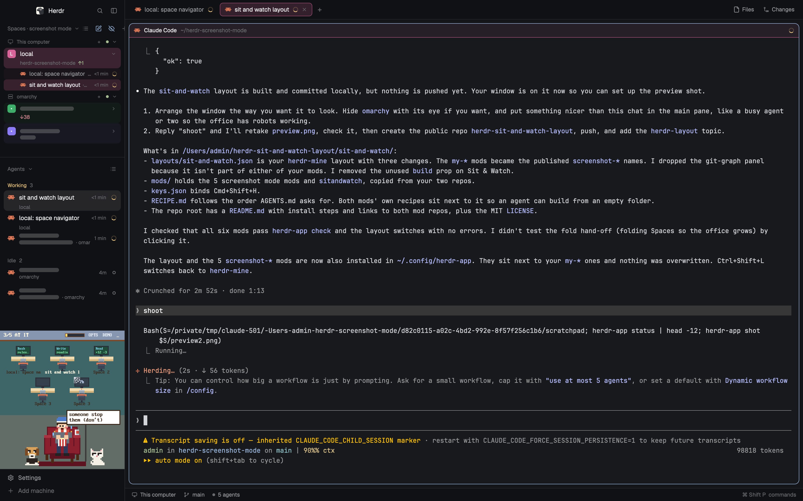

# Sit & Watch layout for Herdr

A [Herdr](https://herdr.dev) layout that puts two mods together: [screenshot mode](https://github.com/funny-it-worked-last-time-gsv/herdr-screenshot-mode) (Spaces and Agents lists, tab bar, pane headers and status bar that can hide client names) and [Sit & Watch](https://github.com/funny-it-worked-last-time-gsv/herdr-sit-and-watch) (your agents as robots at their desks, in the bottom of the sidebar).

See [sit-and-watch/RECIPE.md](sit-and-watch/RECIPE.md) for what it does and how it is built.

## Installation

Ask your agent to add this layout (it reads every file first), or by hand:

1. Copy `sit-and-watch/layouts/sit-and-watch.json` into `~/.config/herdr-app/layouts/`.
2. Copy the six folders in `sit-and-watch/mods/` into `~/.config/herdr-app/mods/`.
3. Merge `sit-and-watch/keys.json` into `~/.config/herdr-app/keys.json` (it binds `cmd-shift-h`).
4. Run `herdr-app do layout.switch '{"name":"sit-and-watch"}'`. `ctrl-shift-l` switches back.

Sit & Watch's optional Claude Code hooks (explosions on ship, sub-agent counts, activity bubbles) live in the [Sit & Watch repo](https://github.com/funny-it-worked-last-time-gsv/herdr-sit-and-watch#installation).
