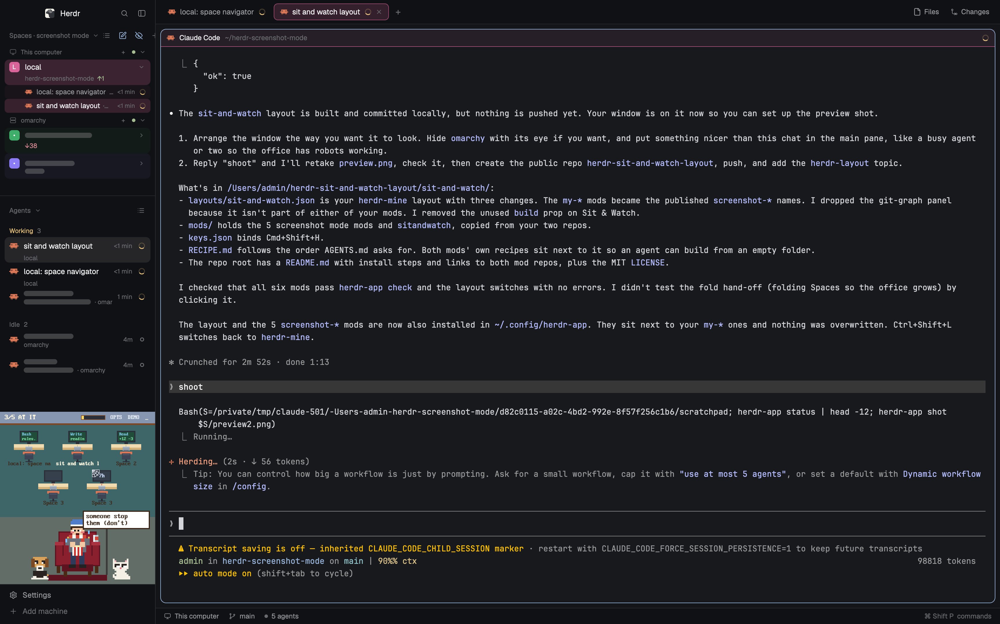

# Sit & Watch

A Herdr window built around two mods. The left sidebar holds the screenshot mode Spaces and Agents lists, and under them the Sit & Watch office, where each agent is a robot at a desk and a developer in a red armchair reacts to how they are doing. The tab bar, pane headers and status bar are the screenshot mode versions too, so one shortcut (Cmd+Shift+H) smudges every hidden space and machine name across the whole window, the office included.

## What you see

Left to right, on the theme's `canvas` background with 1px `border` dividers and no system titlebar (macOS traffic lights at 12, 16):

1. **Sidebar**, 268px wide (drag 44 to 480px), theme `chrome` background. Top to bottom:
   - Brand row, 46px: Herdr's shipped `workspace-chrome` (logo, search, sidebar toggle). Drags the window.
   - Spaces list (`screenshot-spaces`), weight 1, at least 31px. Header reads "Spaces" or "Spaces · screenshot mode", with fold, dense-rows, the phrases pen and the eye. Each space opens into its tabs, agents and sub-agents, with its repo and branch on a line under the name.
   - Agents list (`screenshot-agents`), weight 1, at least 42px. Agents grouped Needs you, Done, Working, Idle, with "12 min" timings.
   - Sit & Watch office (`sitandwatch`), weight 1.3, at least 220px. Pixel-art panel: a 23px header (`N/M AT IT`, power bar, `OPTS`, `DEMO`, `_`), the desks, then the armchair, the pets and the speech bubble.
   - Footer, 69px: `workspace-chrome` with `footer: true` (Settings, Add machine).
2. **Work column**, the rest of the width:
   - Tab bar (`screenshot-tabs`), 42px, drags the window. Tabs tinted with their space's colour, `+`, and Files and Changes buttons on the right.
   - Body with 8px padding and 8px gaps: the active tab's panes, each with a 30px `screenshot-pane` header always showing at the top, 10px corner radius, 1px `border`, 1px `accent` when focused, `background` fill, and 14 x 12px terminal padding. A lone pane keeps its header and frame.
   - A right panel, 368px (280 to 900px), hidden until Files or Changes is clicked. A stack of the shipped `files` and `changes` mods, `files` on top.
   - Status bar (`screenshot-status`), 28px: machine, branch, agent count, `⌘ Shift P commands`.

## How it behaves

- Agent status shows in three places at once. Spaces and Agents rows show the spinner (working), a filled dot (done), the needs-you colour and the idle ring. The office shows the same agents as desks: working desks scroll a log, a blocked one makes the developer spill his popcorn, and finishing ones get cheered. The status bar counts them.
- Cmd+Shift+H, or the eye next to "Spaces", toggles screenshot mode. Hidden spaces and machines become soft smudges in the lists, tab bar, pane headers and status bar, and Sit & Watch draws them as `Space N` or their alias. Aliased phrases are swapped in place everywhere.
- Clicking "Spaces" or "Agents" folds that section to its header row. Its weight drops to 0, so the Sit & Watch office grows into the freed height. Clicking again restores it.
- Dragging the sidebar's right edge resizes it. Dragging the lines between the three sidebar sections resizes them (the sidebar column is `resizable`).
- `_` in the office header minimises it to its header. Its own Options can also pin a height.
- Files and Changes in the tab bar show and swap the right panel.

## Built from

- `layouts/sit-and-watch.json`, cloned from Herdr's `main` (0.1.10). Root `row`: `sidebar` column (`brand`, `sidebar-lists` column of `spaces`, `agents`, `sitandwatch`, then `sidebar-footer`) and `work` column (`tabs`, `work-body` row of `main` and `panel`, then `status`). Keep these ids. Sit & Watch looks for the block id `sitandwatch`, and the screenshot mods find their blocks by mod name to fold them.
- `mods/screenshot-spaces`, `screenshot-agents`, `screenshot-tabs`, `screenshot-pane`, `screenshot-status`: the screenshot mode mods, unchanged from [herdr-screenshot-mode](https://github.com/funny-it-worked-last-time-gsv/herdr-screenshot-mode). Their own brief is `screenshot-mode.RECIPE.md` in this folder.
- `mods/sitandwatch`, unchanged from [herdr-sit-and-watch](https://github.com/funny-it-worked-last-time-gsv/herdr-sit-and-watch), placed with `props: { role: "panel" }`. Its own brief is `sitandwatch.RECIPE.md` in this folder.
- Shipped mods used as they are: `workspace-chrome`, `files`, `changes`.
- `keys.json`: `"global": { "cmd-shift-h": "screenshot-spaces.privacy" }`.
- The two mod families share state through Herdr's shared `privacy` key (`{ on, hidden, phrases }`), read by the same `privacy.js` file copied into each mod. No other link between them.
- Programs run: Sit & Watch calls `hc ls` and `hc get`. `screenshot-spaces` runs `git status` and `git rev-parse` (`exec`) in each space's folder for the repo line. No network.

## Watch out

- Sit & Watch's ship, sub-agent and activity hooks are optional Claude Code hooks that live in the Sit & Watch repo, not here. Without them the office still works but shows no explosions, no `2/5` sub-agent counts and only terminal titles in its bubbles.
- Sit & Watch needs about 220px of height and at least 260px of width to draw the chair and desks. Narrower than 160px, the sidebar mods draw a compact rail.
- Fold works by `layout.resize` with `weight: 0` on the section's block. Giving the Spaces or Agents block a `px` size breaks the hand-off to the office. Keep them as weights.
- If an existing install already has a `cmd-shift-h` binding (for example a clone of screenshot mode under another name), merge rather than replace, or one of them stops toggling.
- The Last command line in pane headers needs the zsh snippet from the screenshot mode repo. Without it that line stays empty.

## Done when

- `herdr-app check` passes for all six mods and `herdr-app status` shows `"layout": "sit-and-watch"` with no errors after `layout.switch {"name":"sit-and-watch"}`.
- The sidebar shows Spaces, Agents and the office, in that order, with the footer under them.
- Starting an agent in any tab adds a desk in the office and a Working row in Agents within a second or two.
- Cmd+Shift+H smudges a hidden space in the Spaces list, the tab bar, the status bar and on its office desk at the same time.
- Folding Spaces makes the office taller. Unfolding gives the height back.
- Files in the tab bar opens the right panel. Clicking it again hides it.
